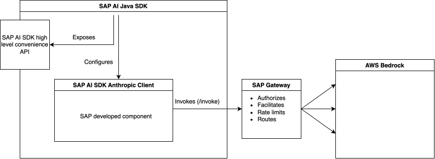
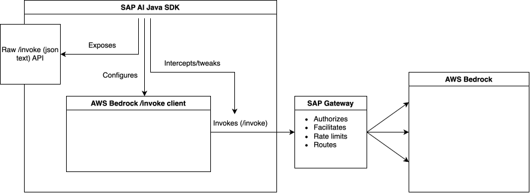
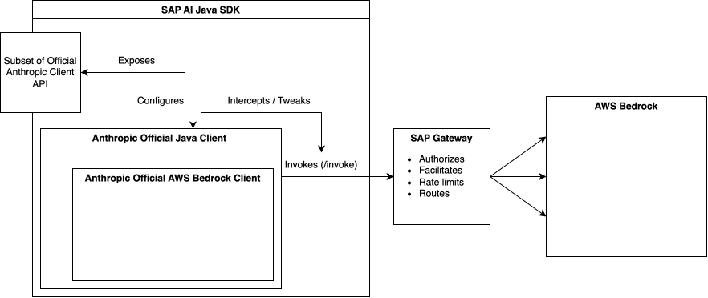
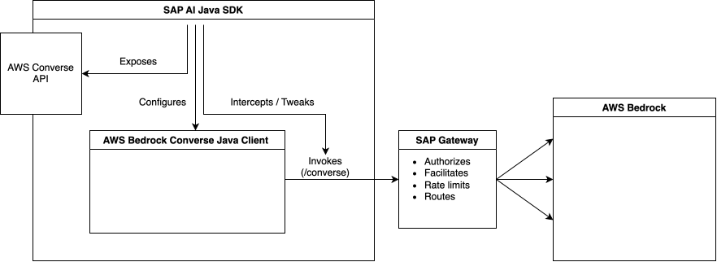
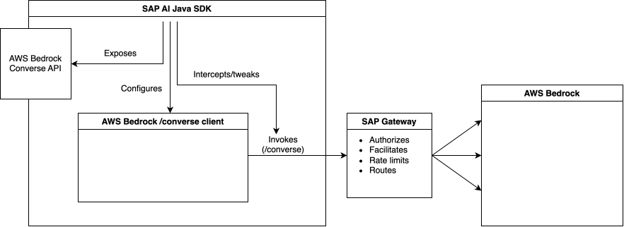

#  Anthropics foundation models

##  Status

- Status: `proposed` (2026-10-27) <!-- [draft | proposed | rejected | accepted | deprecated | superseded by ...] -->
- Contributors: Vladimir Aseev
- Reviewers: Zhongpin Wang
- Next expected status change date: 02.11.2026

##  Context
AI SDK needs to provide users with direct access to Anthropic models. This document enumerates different implementation
approaches with pros and cons for each option.

### Business Requirements
This ADR is required in the context of the backlog items:
- https://github.com/SAP/ai-sdk-java-backlog/issues/449

### Problem Description
AI SDK needs to provide users with direct access to Anthropic models. Currently, the corresponding solution does
not exist. Few solution options exist, the optimal option is to be identified.

### Solution Options
#### Option A: Convenience classes

Client, configuration and operation payload classes (requests, responses and their parts) are written by
hands for every functionality we want to support:



```java
// Hypothetical convenience classes approach
AnthropicChatCompletionResponse response =
    AnthropicClient.forModel(CLAUDE_45_HAIKU)
        .chatCompletion(new AnthropicChatCompletionRequest("What is the capital of France?"));

Stream<AnthropicChatCompletionDelta> stream =
    AnthropicClient.forModel(CLAUDE_45_HAIKU)
        .streamChatCompletionDeltas(new AnthropicChatCompletionRequest("Tell me a story"));
```

| Aspect                 | Value                                                                                                                                                                                 |
|------------------------|---------------------------------------------------------------------------------------------------------------------------------------------------------------------------------------|
| Maintenance effort     | High — every upstream API change requires SDK updates                                                                                                                                 |
| Code footprint         | Large. In order to provide typed API many classes will have to be written, covered with tests and documented                                                                          |
| User value             | Moderate. All new functionality from Antropics won't be supported immediately (lag). Most/much of functionality won't be supported at all given the development capacity constraints. |
| API stability          | Moderade to high — SAP owns the contract but on upstream API changes we may have to introduce breaking changes to our API                                                             |
| Backend replaceability | Hard — POJOs tightly coupled to Bedrock wire format, almost entire codebase will have to be re-written                                                                                |


#### Option B: Raw Bedrock invoke API

Expose the AWS Bedrock SDK `BedrockRuntimeClient` configured for SAP AI Core, with all serialization and response parsing left to the user.



```java
// Chat completion — user owns request serialization and response parsing
BedrockRuntimeClient bedrockClient = BedrockRuntimeClient.builder()
    .httpClient(SapBedrockHttpClient.forModel(CLAUDE_45_HAIKU))
    .build();

String requestBody = """
    {
      "anthropic_version": "bedrock-2023-05-31",
      "max_tokens": 1000,
      "messages": [{"role": "user", "content": "What is the capital of France?"}]
    }
    """;

InvokeModelResponse response = bedrockClient.invokeModel(
    InvokeModelRequest.builder()
        .modelId(CLAUDE_45_HAIKU.id())
        .body(SdkBytes.fromUtf8String(requestBody))
        .build());

String responseBody = response.body().asUtf8String();
// user parses responseBody JSON manually

// Streaming
bedrockClient.invokeModelWithResponseStream(
    InvokeModelWithResponseStreamRequest.builder()
        .modelId(CLAUDE_45_HAIKU.id())
        .body(SdkBytes.fromUtf8String(requestBody))
        .build(),
    InvokeModelWithResponseStreamResponseHandler.builder()
        .onEventStream(stream -> stream
            .filter(e -> e instanceof PayloadPart)
            .map(e -> ((PayloadPart) e).bytes().asUtf8String())
            .forEach(chunk -> { /* user parses each chunk JSON manually */ }))
        .build());
```

| Aspect          | Value                                                                            |
|-----------------|----------------------------------------------------------------------------------|
| Maintenance effort | Near zero — no types owned                                                    |
| Code footprint | Minimal                                                                           |
| User value | Low — user owns JSON serialization, response parsing, and SSE chunk handling          |
| API stability | Stable at transport level; unstable at payload level — user owns the wire format   |
| Backend replaceability | Virtually impossible — user code is tightly coupled to Bedrock wire format|

### Option C: Official Anthropic Java SDK with Invoke AWS Bedrock Backend

Use `com.anthropic:anthropic-java-core` as the typed API layer.
Replace its HTTP transport (`com.anthropic.core.http.HttpClient`) with SAP's authenticated Apache HTTP client.
Expose parts of official anthropic api we support (sub-clients implemented by anthropic)



```java
// Chat completion
Message response =
    AiCoreAnthropicClient.forModel(CLAUDE_45_HAIKU)
        .client()
        .messages()
        .create(
            MessageCreateParams.builder()
                .model(CLAUDE_45_HAIKU.name())
                .maxTokens(1000)
                .addUserMessage("What is the capital of France?")
                .build());

String text = response.content().stream()
    .filter(ContentBlock::isText)
    .map(b -> b.asText().text())
    .collect(joining());

// Streaming
try (var stream =
    AiCoreAnthropicClient.forModel(CLAUDE_45_HAIKU)
        .client()
        .messages()
        .createStreaming(params)) {
  stream.stream()
      .filter(RawMessageStreamEvent::isContentBlockDelta)
      .map(e -> e.asContentBlockDelta().delta().asTextDelta().text())
      .forEach(System.out::print);
}
```

| Aspect                 | Value                                                                           |
|------------------------|---------------------------------------------------------------------------------|
| Maintenance effort     | Low — SDK absorbs upstream changes |
| Code footprint         | Small — bridge only: `AiCoreAnthropicClient`, `SapAnthropicHttpClient` |
| User value             | High — official, fully-typed, well-documented Anthropic API |
| API stability          | Stable — Anthropic owns and maintains the contract |
| Backend replaceability | Easy — transport is swappable without breaking user code |


### Option D: Official Anthropic Java SDK with Converse AWS Bedrock Backend

Use `com.anthropic:anthropic-java-core` as the typed API layer.
Replace its HTTP transport (`com.anthropic.core.http.HttpClient`) with SAP's authenticated Apache HTTP client.
Expose parts of official anthropic api we support (sub-clients implemented by anthropic)



```java
// Chat completion
Message response =
    AiCoreAnthropicClient.forModel(CLAUDE_45_HAIKU)
        .client()
        .messages()
        .create(
            MessageCreateParams.builder()
                .model(CLAUDE_45_HAIKU.name())
                .maxTokens(1000)
                .addUserMessage("What is the capital of France?")
                .build());

String text = response.content().stream()
    .filter(ContentBlock::isText)
    .map(b -> b.asText().text())
    .collect(joining());

// Streaming
try (var stream =
    AiCoreAnthropicClient.forModel(CLAUDE_45_HAIKU)
        .client()
        .messages()
        .createStreaming(params)) {
  stream.stream()
      .filter(RawMessageStreamEvent::isContentBlockDelta)
      .map(e -> e.asContentBlockDelta().delta().asTextDelta().text())
      .forEach(System.out::print);
}
```

| Aspect                 | Value                                                                                                                     |
|------------------------|---------------------------------------------------------------------------------------------------------------------------|
| Maintenance effort     | Very high - implementation depends not only on Anthropic API changes but also on Converse AWS API changes                 |
| Code footprint         | Large — high level mapping between the APIs is needed. some features might be impossible to map                           |
| User value             | Medium — official, fully-typed, well-documented Anthropic API but scope is limited by not all operations supported/mapped |
| API stability          | Low — glue (mapping) between Anthropics API and Converse API is brittle                                                   |
| Backend replaceability | Difficult — implementation will have to be redone                                                                         |


### Option E: Official Converse AWS Bedrock Java API with Anthropic models via SAP gateway

Use `software.amazon.awssdk:bedrockruntime` as the typed API layer.
Configure `BedrockRuntimeClient` with SAP's authenticated HTTP credentials and endpoint override pointing to SAP AI Core's gateway.
The Converse API provides a model-agnostic typed interface — all request/response types (`ConverseRequest`, `ConverseResponse`, `Message`, `ContentBlock`, etc.) are owned by AWS.



```java
// Build SAP-authenticated BedrockRuntimeClient
BedrockRuntimeClient bedrockClient =
    BedrockRuntimeClient.builder()
        .endpointOverride(URI.create(AiCoreService.getInferenceDestination(CLAUDE_45_HAIKU).getUri()))
        .credentialsProvider(() -> AwsBasicCredentials.create("sap", "sap")) // auth handled by destination
        .httpClient(SapBedrockHttpClient.forModel(CLAUDE_45_HAIKU))
        .region(Region.US_EAST_1) // required by SDK builder, overridden by endpoint
        .build();

// Chat completion via Converse API
ConverseResponse response = bedrockClient.converse(
    ConverseRequest.builder()
        .modelId(CLAUDE_45_HAIKU.id())
        .messages(
            Message.builder()
                .role(ConversationRole.USER)
                .content(ContentBlock.fromText("What is the capital of France?"))
                .build())
        .build());

String text = response.output()
    .message()
    .content()
    .stream()
    .filter(ContentBlock::hasText)
    .map(ContentBlock::text)
    .collect(joining());

// Streaming via ConverseStream
bedrockClient.converseStream(
    ConverseStreamRequest.builder()
        .modelId(CLAUDE_45_HAIKU.id())
        .messages(
            Message.builder()
                .role(ConversationRole.USER)
                .content(ContentBlock.fromText("Tell me a story"))
                .build())
        .build(),
    ConverseStreamResponseHandler.builder()
        .onEventStream(stream -> stream
            .filter(e -> e instanceof ContentBlockDeltaEvent)
            .map(e -> ((ContentBlockDeltaEvent) e).delta().text())
            .forEach(System.out::print))
        .build());
```

| Aspect                 | Value                                                                                                                                                                                             |
|------------------------|---------------------------------------------------------------------------------------------------------------------------------------------------------------------------------------------------|
| Maintenance effort     | Low for AWS SDK changes — typed classes are SDK-owned; but Anthropic-specific features (extended thinking, tool use variants) may lag behind the native Anthropic API                             |
| Code footprint         | Small — bridge only: SAP endpoint/credential wiring; no request/response mapping needed                                                                                                           |
| User value             | Medium — familiar AWS SDK patterns for teams already using Bedrock; but Anthropic-specific parameters (e.g. `betas`, prompt caching) are not exposed (against the purpose of "foundation models") |
| API stability          | High — AWS Converse API is stable and model-agnostic; Anthropic-specific capabilities limited to what Converse supports                                                                           |
| Backend replaceability | Moderate — switching to a non-Bedrock backend requires replacing the AWS SDK dependency; Converse API types are AWS-specific                                                                      |


## Decision
Official Anthropic Java SDK with Invoke AWS Bedrock Backend (Option C) is proposed.

## Rationale

Every aspect value is scored between 1 and 5 points
Every option receives result as a sum of its aspect values.

| Aspect                 | A: Convenience classes | B: Raw Bedrock Invoke | __C: Anthropic SDK + Invoke__ | D: Anthropic SDK + Converse | E: AWS Converse SDK |
|------------------------|------------------------|-----------------------|-------------------------------|-----------------------------|---------------------|
| Maintenance effort     | High (2)               | Near zero (5)         | __Low (4)__                   | Very high (1)               | Low (4)             |
| Code footprint         | Large (2)              | Minimal (5)           | __Small (4)__                 | Large (1)                   | Small (4)           |
| User value             | Moderate (3)           | Low (1)               | __High (5)__                  | Moderate (3)                | Moderate (3)        |
| API stability          | Moderate–high (3.5)    | Low (payload) (1)     | __High (5)__                  | Low (1)                     | Moderate (3)        |
| Backend replaceability | Hard (1)               | Impossible (1)        | __Easy (5)__                  | Difficult (2)               | High (4)            |
| Score                  | 12.5                   | 13                    | __23__                        | 8                           | 18                  |

## Consequences, New Dependencies, Open Points, Next Steps
<!-- Describe anything else that needs to be done and lists dependencies to other services that need to be introduced. -->